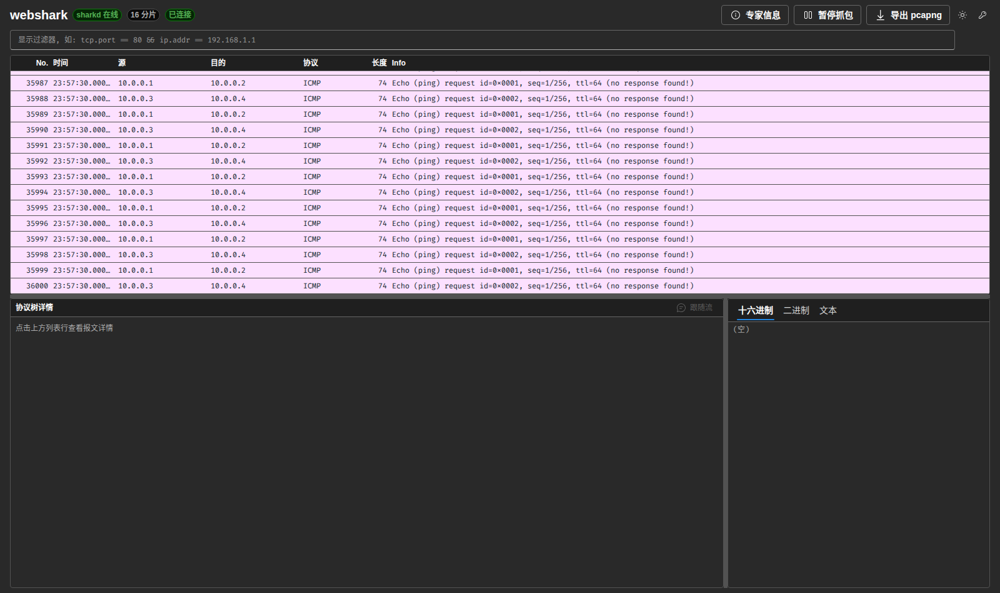

# webshark

webshark 是 **Wireshark 的 Web 前端**（仅服务端）：不生产 pcapng、也不解析协议。pcapng 分片由外部 `dumpcap` 以环形滚动方式写入 spool 目录，协议解析交给 Wireshark 自带的 `sharkd` daemon（经 Unix socket 访问），webshark 只做装配、路由与流式推送。浏览器中得到与 Wireshark 桌面端一致的体验：



## 特性

- **Wireshark 三面板**：包列表（虚拟滚动）｜协议树详情｜原始字节 hex（hex/bin/ascii 三态），布局对齐 Wireshark 桌面端，深色工业主题为默认。
- **实时追帧**：服务端按游标增量拉取、微批推送；分片轮换无感切换，断线 60s 内重连续推（容量满时服务端会淘汰最旧断线会话腾位，被淘汰者重连按新流对齐）。
- **dfilter 筛选**：sharkd 语法校验与字段/协议补全；筛选模式自环窗起点逐片走查。
- **专家信息、流跟随**：经 sharkd tap/follow 透传。
- **合并导出**：环窗内全部分片按 mtime 升序拼接为单一 pcapng 下载（导入桌面 Wireshark 做跨分片分析）。
- **可嵌入**：根包 `webshark` 提供 `Config`/`New`/`Handler`/`Close`，一行装配进已有 Go 服务；`sharkd` 子包是独立的 sharkd 客户端 SDK（`import "github.com/iotxfoundry/webshark/sharkd"`），覆盖 sharkd 全部 19 个 RPC 方法，支持路径型（`/run/webshark/sharkd.sock`）与抽象型（`@name`）Unix socket。
- **纯 Go、无 cgo**：Go 直接依赖仅 fsnotify 与 gorilla/websocket（testify 仅测试）。
- **鉴权**：Bearer token / `?token=`（WebSocket 与下载直链），常量时间比较；token 录入页始终公开。

## 架构

```
 dumpcap ──环形滚动写──▶ spool 目录 /var/lib/webshark ──只读列举──┐
 (网卡抓包)              net_*.pcapng 分片                        │
                                                                  ▼
 sharkd ◀──── JSON-RPC / Unix socket ────▶ webshark 服务 ──HTTP/WS──▶ 浏览器 SPA
 (协议解析)                                 (本项目, 纯 Go)          React + Fluent UI
```

数据流向：dumpcap 写分片 → webshark 检测新分片并驱动 sharkd `load` → 按游标拉增量行微批推送 → 浏览器 WebSocket 渲染。接口与流行为契约见 [docs/api.md](docs/api.md)（唯一契约事实源），进程与包职责见 [docs/architecture.md](docs/architecture.md)。

## 快速开始

前置：安装 Wireshark（提供 `sharkd` 与 `dumpcap`，本机需能抓包）、Go 1.27、Node 22 + yarn 4（仅构建前端需要）。

1. 构建并产出分片：

```sh
make all                      # 前端打包 web/dist.zip + 二进制 bin/webshark
sudo mkdir -p /var/lib/webshark /run/webshark
sudo dumpcap -i eth0 -b filesize:8388608 -b files:16 -w /var/lib/webshark/net.pcapng
```

2. 启动 sharkd daemon：

```sh
sudo sharkd -a unix:/run/webshark/sharkd.sock --foreground
```

3. 启动 webshark，浏览器打开 `http://127.0.0.1:8080`：

```sh
bin/webshark -listen 127.0.0.1:8080
```

没有 dumpcap 时可手工落盘验证链路（text2pcap 造包后按 `net_*.pcapng` 命名放入 spool 目录）。

## Docker

镜像三合一：`dumpcap`（抓包）+ `sharkd`（解析）+ `webshark`（服务），单容器即完整 appliance。运行时基座为 Debian testing，其 sharkd/dumpcap 为 4.6.x，与本项目协议校准基线一致。

```sh
make docker       # = make build + docker build -f build/Dockerfile
```

镜像内即含三件套（`dumpcap`/`sharkd` 来自 Debian testing 的 wireshark-common 4.6.x；`webshark` 二进制在编译期内嵌前端），构建为单阶段打包本地产物，无多阶段构建。

### iframe 嵌入（宿主注入令牌与主题）

页面经 `window.self !== window.top` 自动识别嵌入形态并移除自身品牌（宿主系统头承载标题）；令牌与主题由宿主经 postMessage 注入，页面不提供切换入口，也不落盘；宿主首个非空 `set-token` 到达前数据面不启动（避免挂载即 401）。

```js
const win = document.querySelector('iframe').contentWindow;
// iframe onload 后（或收到 {type:"webshark:ready"} 后）注入:
win.postMessage({ type: 'webshark:set-token', token: '<宿主JWT>' }, '*');
win.postMessage({ type: 'webshark:set-theme', theme: 'light' }, '*');  // 宿主主题切换时重发
// iframe 内遇到 401 时会上报:
window.addEventListener('message', e => {
  if (e.data?.type === 'webshark:unauthorized') refreshTokenAndResend();
});
```

令牌与主题均由宿主管（iframe 内不落盘），宿主登出/换肤后重发即可；完整协议见 `web/ui/DESIGN.md`。

抓宿主机物理网卡（`--network host` 才能看到物理网卡；抓包需授予网络能力；spool 建议挂持久卷）：

```sh
docker run -d --name webshark \
  --network host \
  --cap-add NET_ADMIN --cap-add NET_RAW \
  -e WEBSHARK_TOKEN=$(openssl rand -hex 32) \
  -v /var/lib/webshark:/var/lib/webshark \
  webshark
```

只分析已有分片（不抓包，无需能力与 host 网络）：

```sh
docker run -d --name webshark -p 8080:8080 \
  -e DUMPCAP_IFACE=none \
  -e WEBSHARK_TOKEN=$(openssl rand -hex 32) \
  -v "$PWD/pcap:/var/lib/webshark:ro" \
  webshark
```

| 环境变量 | 默认值 | 说明 |
|---|---|---|
| `LISTEN` | `0.0.0.0:8080` | 监听地址；非 loopback 必须配 `WEBSHARK_TOKEN`（服务端安全阀强制，缺失即退出） |
| `WEBSHARK_TOKEN` | 空 | API 鉴权 token |
| `SPOOL` | `/var/lib/webshark` | 分片目录（建议挂持久卷） |
| `DUMPCAP_IFACE` | `eth0` | 抓包网卡；`none` = 不启动抓包 |
| `DUMPCAP_FILTER` | 空 | BPF 捕获过滤串 |
| `DUMPCAP_FILESIZE` | `8388608` | 单分片字节数 |
| `DUMPCAP_FILES` | `16` | 分片数（容器内自动与 `-ring` 对齐） |
| `DUMPCAP_STDERR` | `/dev/null` | dumpcap stderr 去向（其 `\rPackets: N` 进度行在容器日志中会与其他进程日志穿插；调试时设 `/dev/stderr` 或文件路径） |
| `SERIAL_PORTS` | 空 | 串口采集列表，逗号分隔 `/dev/ttyUSB0@115200,/dev/ttyUSB1@9600`（`@波特率` 缺省 115200，仅用于 3.5 字符静默成帧时序，不碰 termios）。**协议无关采集**：Modbus RTU、FT1.2（IEC 101/103）、DL/T 645、DL/T 698.45 等多协议可混接，深度解析由容器内 sharkd 的 Lua 分发器完成；空 = 不采串口。部署前提见 [docs/deployment.md](docs/deployment.md)「串口与 CAN」 |
| `CAN_IFACES` | 空 | SocketCAN 接口名，逗号分隔 `can0,can1`；空 = 不采 CAN。两者都空则 pktdump 整个不起 |

说明：容器内进程以 root 运行，dumpcap 的抓包能力来自运行时授予的 capabilities，不写入镜像；默认监听 `0.0.0.0` 时必须设置 token，如需免 token 请 `--network host` 并设 `LISTEN=127.0.0.1:8080`。

**arm64 板载二进制部署**（无 docker，二进制+systemd，Lua 启用 sharkd 套件、串口/CAN 采集与三服务单元）：见 [docs/deployment.md](docs/deployment.md)「arm64 板载部署」——含布局、逐字单元与真机验收 checklist。

**抓包怎么给网卡与权限**（host 网络抓宿主网卡 / `container:<名>` 抓另一容器 / bridge 只见自身 / `none` 纯分析、capabilities 与挂载的判据、排障命令）：见 `docs/deployment.md`「Docker 部署与抓包」——网卡不需要挂载，由网络模式决定看见谁、capabilities 决定能不能抓。

## CLI 参数

| 参数 | 默认值 | 说明 |
|---|---|---|
| `-listen` | `127.0.0.1:8080` | HTTP 监听地址 |
| `-sharkd` | `/run/webshark/sharkd.sock` | sharkd daemon 的 Unix socket 路径 |
| `-spool` | `/var/lib/webshark` | pcapng 分片目录（dumpcap 滚动写入） |
| `-ring` | `16` | 环窗分片数（对齐 `dumpcap -b files:16`） |
| `-token` | 空 | API 鉴权 token；为空时读环境变量 `WEBSHARK_TOKEN` |
| `-web-dir` | 空 | 静态站点磁盘目录（开发用；空 = 内嵌 `web/dist.zip`） |
| `-version` | — | 打印版本退出 |

## 配置与鉴权

- **安全阀**：监听非 loopback 地址且未配置 token 时拒绝启动（退出码 1）。对外暴露请务必配置 token 并置于 TLS 反代之后。
- **token 规则**：未配置时全部开放；配置后 `/api/*` 需要 `Authorization: Bearer <token>`，WebSocket 握手与下载直链用 `?token=<token>`（浏览器无法注入 header）。静态资源始终公开（token 录入页需要能被加载）。token 常量时间比较。
- **前端**：token 存 `localStorage`，收到 401 时清除并弹出录入页。
- **环境变量**：`WEBSHARK_TOKEN` 可替代 `-token`，便于 systemd 部署注入。

## 开发指南

```sh
make all      # 全量构建：前端产物 + 二进制
make build    # 仅 Go 二进制（前端未构建时服务端回退提示页）
make web      # 前端构建并打包为 web/dist.zip（入库产物）
make test     # Go 测试
make vet      # go vet ./...
make fmt      # gofmt -l -w .
```

前端开发（React 18 + Fluent UI v9 + Vite 6 + TypeScript，yarn 4）：

```sh
cd web/ui
yarn install --immutable
yarn typecheck && yarn test && yarn lint
yarn dev            # 开发服务器
yarn build          # 产物输出 web/ui/dist/（入库的是 make web 打出的 dist.zip）
```

后端开发时可用磁盘目录替代内嵌产物：

```sh
go run ./cmd/webshark -web-dir web/ui/dist
```

嵌入到已有 Go 服务：

```go
srv, err := webshark.New(webshark.Config{
	SpoolDir:   "/var/lib/webshark",
	SharkdSock: "/run/webshark/sharkd.sock",
})
// srv.Handler() 即完整路由：/api/* + SPA 静态站点
```

接口契约（路径、线格式、流行为）以 [docs/api.md](docs/api.md) 为准；部署（systemd/反代/权限）见 [docs/deployment.md](docs/deployment.md)。

## 能力边界

以下为当前架构的明确边界，不是待办：

- **单分片视图**：sharkd 单会话同一时刻只 load 一个文件，同一视图只显示一个分片；跨分片筛选不支持（走合并导出 + 桌面 Wireshark）。
- **冷启动不回放环窗历史**：实时流锚定最新分片，历史阅读走筛选模式或导出。
- **Conversations/Endpoints 不提供**：依赖 sharkd build 是否注册 stats_tree 塔，本项目未使用。
- **sharkd 为解析事实源**：字段语义、dfilter 语法、补全行为均随 Wireshark 版本而定（当前按 4.6.x 实现）。

## 验证链路

text2pcap 造包 → dumpcap/手工落盘分片 → sharkd 4.6.9 → 列表/详情/hex/专家信息/筛选/导出全链路实测通过。

## License

[Apache-2.0](LICENSE)。控制面与前端抽取自工业网关抓包插件，已按独立仓库重组。
